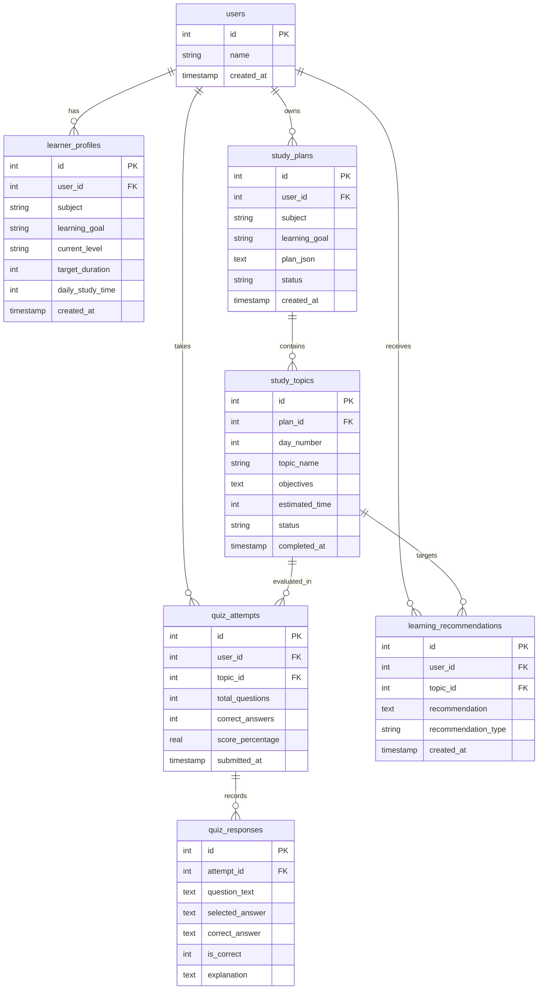

# 🎓 AI Personalized Learning Coach

[](https://www.python.org/)
[](https://streamlit.io/)
[](https://aistudio.google.com/)
[](https://www.sqlite.org/)
[](LICENSE)

An intelligent, full-stack AI-powered study platform designed to understand learner goals, knowledge levels, and available study hours to dynamically create day-by-day curricula, generate novel multiple-choice quizzes, evaluate responses with independent Python logic, diagnose weak concepts, and provide adaptive recommendations.

> **Project Organization:** XPERT CHAMPS  
> **Project Category:** Generative AI / Personalized Learning  
> **Project Duration:** 1 Week Internship Project  

---

## 📑 Table of Contents

- [1. Problem Statement](#1-problem-statement)
- [2. Primary Objectives](#2-primary-objectives)
- [3. Core Features](#3-core-features)
- [4. System Architecture](#4-system-architecture)
- [5. Database Schema](#5-database-schema)
- [6. Technology Stack](#6-technology-stack)
- [7. Project Directory Structure](#7-project-directory-structure)
- [8. Installation & Setup Guide](#8-installation--setup-guide)
- [9. How to Run the Application](#9-how-to-run-the-application)
- [10. Testing & Validation](#10-testing--validation)
- [11. Google Gemini API Integration](#11-google-gemini-api-integration)
- [12. Screenshots & UI Walkthrough](#12-screenshots--ui-walkthrough)
- [13. Limitations & Future Enhancements](#13-limitations--future-enhancements)
- [14. Git & GitHub Push Instructions](#14-git--github-push-instructions)
- [15. Authors & Acknowledgments](#15-authors--acknowledgments)

---

## 1. Problem Statement

Standard online learning resources frequently offer static, one-size-fits-all curricula that ignore a learner's existing background, target timeframe, and daily study availability. Furthermore, generic chatbots suffer from scoring hallucinations, lack persistent progress tracking, and fail to provide structured topic-by-topic guidance that adapts to assessment results.

**AI Personalized Learning Coach** solves this by uniting:
1. **Dynamic Curricula:** Tailored day-by-day milestones respecting target durations and daily available minutes.
2. **Dynamic MCQ Generation:** Novel assessment questions generated directly for the active topic.
3. **Deterministic Python Scoring:** Exact mathematical evaluation calculated via Python code, independent of LLM hallucinations.
4. **Adaptive Guidance Engine:** Performance-tiered recommendations (<50% Revision, 50–69% Practice, 70–84% Good Understanding, 85%+ Progression).
5. **Persistent Relational Storage:** Complete SQLite audit trail preserving study plans, quizzes, and telemetry across app restarts.

---

## 2. Primary Objectives

- **Personalized Onboarding:** Capture subject, goal, knowledge level (Beginner/Intermediate/Advanced), target duration in days, and daily study time in minutes.
- **Dynamic Study Plan Generation:** Leverage Google Gemini API to structure realistic daily learning schedules with objectives, subtopics, practice activities, and resources.
- **Novel MCQ Generation:** Produce 5 multiple-choice questions for any topic with 4 choices, answer key, and pedagogical explanations.
- **Objective Evaluation:** Execute answer key matching and score calculation strictly in Python.
- **Adaptive Recommendations:** Catalog weak and strong topics from actual attempt history to recommend revision or progression.
- **Real-Time Analytics:** Visualize score trajectories, curriculum completion rates, and learning history using Plotly and Streamlit.

---

## 3. Core Features

### 🏠 Module 1: Home Page & Landing Experience
- Professional SaaS hero section with custom typography (Google Fonts *Inter* & *Outfit*).
- 6 core platform capability cards with hover micro-interactions.
- Step-by-step "How It Works" workflow pipeline.
- Technology architecture overview and Xpert Champs branding footer.

### 👤 Module 2: Student Profile & Onboarding
- Strict validation: forbids empty subjects, short goals, invalid durations (<1 or >90 days), and invalid daily study times (<15 or >600 minutes).
- Multi-student support: dynamically switch between learners or register new students.
- Persistent profile storage in SQLite `learner_profiles` table.

### 📅 Module 3 & 4: Study Plan Generator & Interactive Dashboard
- Generates day-by-day study plans matching exact target days and daily study minutes.
- Real-time progress metric cards: Total Days, Total Topics, Completed Topics, Pending Topics, Completion Percentage.
- Interactive topic cards: Mark topics as Completed or Pending, launch practice quizzes, or open deep AI study guides.
- Ability to regenerate plans or switch between multiple study plans per student.

### 📝 Module 5 & 6: AI Quiz Generator & Interactive Assessment Page
- Generates 5 novel MCQs for any selected curriculum topic on-demand.
- Clean quiz interface with selectable radio choices, progress bar, and confirmation checkbox before submission.
- Prevents accidental duplicate submissions via session state protection.
- Immediate post-submission review: reveals score percentage, performance tier badge, user selection, correct answer, and full pedagogical explanation.
- **Strict Scoring Rule:** Python compares selections to the answer key; Gemini is never asked to calculate the score.

### 🎯 Module 7 & 8: AI Performance Feedback & Adaptive Recommendations
- Classifies scores into 4 configurable guidance tiers:
  - **Below 50% (LOW):** Recommends core revision, simpler breakdown, and re-taking practice quiz.
  - **50%–69% (MEDIUM):** Recommends additional practice on missed questions.
  - **70%–84% (GOOD):** Consolidates learning with quick revision before moving forward.
  - **85%+ (HIGH):** Recommends progression to the next topic and suggests a hands-on mini-project challenge.
- Tracks multi-attempt performance over time for the same topic.
- On-demand structured study guide generator with code examples, common pitfalls, and self-checks.

### 📊 Module 9: Progress Dashboard
- 100% database-driven telemetry (no hardcoded statistics).
- Visualizations built with Plotly:
  - Score progression line chart with target understanding threshold.
  - Donut chart showing completed vs. pending topics.
- Categorized list of weakest topics requiring revision vs. strongest mastered topics.
- Dynamic "Recommended Next Milestone" banner.

### 📜 Module 10: Learning History & Persistent Resumption
- Three-tab historical review: Study Plans History, Quiz Attempts History, and Recommendations Log.
- Direct "Reopen & Continue Plan" button restoring any previous study plan into active state.
- All historical data persists across full application restarts.

### ⚙️ Module 11: Settings & Credential Management
- UI-based Gemini API key configuration securely written to local `.env`.
- Model selection (`gemini-2.5-flash` / `gemini-1.5-flash`).
- Live SQLite database table health check and row counts.
- Masked secret inputs to guarantee zero credential leaks in logs or UI.

---

## 4. System Architecture

```mermaid
graph TD
    User([Learner / Student]) -->|Interacts with UI| Streamlit[Streamlit Multi-Page SaaS UI]
    
    subgraph UI Pages
        P0[Home Landing Page]
        P1[1_Student_Profile]
        P2[2_Study_Plan]
        P3[3_Practice_Quiz]
        P4[4_AI_Feedback]
        P5[5_Progress_Dashboard]
        P6[6_Learning_History]
        P7[7_Settings]
    end

    Streamlit --> UI Pages
    
    subgraph Core Backend Modules
        Val[validators.py]
        LP[learning_plan.py]
        QM[quiz_manager.py]
        RE[recommendation_engine.py]
        AN[analytics.py]
        AI[ai_service.py]
    end
    
    UI Pages --> Core Backend Modules
    
    QM -->|Scores Mathematically| PyScore[Python Scoring Engine]
    AI -->|Structured JSON Prompting| GeminiAPI[Google Gemini API / Fallback Engine]
    
    Core Backend Modules --> DB[(SQLite Database: learning_coach.db)]
```

---

## 5. Database Schema

Foreign key constraints are explicitly enabled (`PRAGMA foreign_keys = ON;`).



---

## 6. Technology Stack

| Technology | Purpose | Version |
| :--- | :--- | :--- |
| **Python** | Application logic, scoring, and data processing | `>= 3.10` (Tested on `3.13`) |
| **Streamlit** | Multi-page interactive SaaS web application | `^1.45.1` |
| **Google Gen AI SDK** | Official Gemini client for study plans and quizzes | `google-genai ^0.1.1` |
| **SQLite3** | Relational storage with foreign key constraints | Built-in |
| **Plotly** | Dynamic interactive charts and telemetry visuals | `^6.8.0` |
| **python-dotenv** | Environment variable management | `^1.1.1` |
| **pytest** | Automated test suite execution | `^9.1.1` |

---

## 7. Project Directory Structure

```text
AI PERSONALIZED LEARNING COACH/
│
├── app.py                      # Module 1: Home & Landing Page
├── ai_service.py               # Module 5: Google Gemini API integration & fallbacks
├── learning_plan.py            # Module 3 & 4: Study plan lifecycle & progress calculations
├── quiz_manager.py             # Module 5 & 6: MCQ generation & Python scoring engine
├── recommendation_engine.py    # Module 7 & 8: Adaptive guidance & weak-topic categorization
├── database.py                 # Module 4: SQLite relational schema & CRUD operations
├── analytics.py                # Module 9 & 10: Telemetry, history queries, and metrics
├── validators.py               # Input validation for profiles, plans, and quizzes
├── seed_demo_data.py           # Demonstration database seeder
│
├── pages/                      # Multi-Page Streamlit Navigation
│   ├── 1_Student_Profile.py    # Module 2: Profile Onboarding & Setup
│   ├── 2_Study_Plan.py         # Module 4: Study Plan Dashboard & Curriculum View
│   ├── 3_Practice_Quiz.py      # Module 6: Quiz Interface & Answer Review
│   ├── 4_AI_Feedback.py        # Module 7 & 8: AI Feedback & Adaptive Recommendations
│   ├── 5_Progress_Dashboard.py # Module 9: Analytics & Telemetry Dashboard
│   ├── 6_Learning_History.py   # Module 10: Persistent Learning History & Reopen
│   └── 7_Settings.py           # Module 11: API Key Config, Models, and Maintenance
│
├── utils/                      # Utilities & Configuration
│   ├── __init__.py
│   ├── config.py               # Configuration constants, thresholds, and .env loading
│   ├── helpers.py              # Score math, JSON sanitization, and tier formatting
│   └── ui_components.py        # Shared sidebar, footer, and CSS loaders
│
├── assets/                     # Frontend Assets & Custom Styling
│   └── styles.css              # Custom SaaS styling, cards, and Google Fonts
│
├── sample_data/                # Reference Data
│   └── example_learning_plan.json # Specimen 7-day Python study plan
│
├── tests/                      # Automated Unit & Integration Tests (20 Scenarios)
│   ├── __init__.py
│   ├── test_validators.py      # Validates profile constraints, schemas, durations
│   ├── test_database.py        # Validates SQLite CRUD, FK constraints, and persistence
│   ├── test_learning_plan.py   # Validates study plan generation & completion math
│   ├── test_quiz_manager.py    # Validates deterministic Python scoring & repeated attempts
│   ├── test_recommendations.py # Validates adaptive thresholds & weak/strong categorization
│   └── test_end_to_end_journey.py # Full 15-step real-world journey test
│
├── learning_coach.db           # Persistent SQLite Database
├── requirements.txt            # Python dependencies
├── .env.example                # Example environment variable template
├── .env                        # Active environment credentials (git-ignored)
├── .gitignore                  # Git ignore rules
└── README.md                   # Comprehensive project documentation
```

---

## 8. Installation & Setup Guide

### Step 1: Clone the Repository
```bash
git clone https://github.com/your-username/ai-personalized-learning-coach.git
cd "ai-personalized-learning-coach"
```

### Step 2: Create and Activate a Virtual Environment
```bash
# Windows
python -m venv venv
.\venv\Scripts\activate

# macOS / Linux
python3 -m venv venv
source venv/bin/activate
```

### Step 3: Install Required Dependencies
```bash
pip install -r requirements.txt
```

### Step 4: Configure Environment Variables
Copy `.env.example` to `.env`:
```bash
# Windows (PowerShell)
Copy-Item .env.example .env

# Linux / macOS
cp .env.example .env
```

Open `.env` and configure your Google Gemini API key:
```env
GEMINI_API_KEY=AIzaSyYourActualGeminiApiKeyHere
DATABASE_PATH=learning_coach.db
GEMINI_MODEL=gemini-2.5-flash
LOG_LEVEL=INFO
```
*(Alternatively, you can enter the API key directly via the **Settings** page in the running app!)*

---

## 9. How to Run the Application

Run the Streamlit application using:
```bash
python -m streamlit run app.py
```
Or simply:
```bash
streamlit run app.py
```

The web application will open in your browser at:
`http://localhost:8501`

*(Optional) To seed realistic demo data for immediate exploration:*
```bash
python seed_demo_data.py
```

---

## 10. Testing & Validation

The project contains a comprehensive automated test suite with **20 test cases** covering every scenario specified in the requirements.

### Run All Tests with pytest
```bash
python -m pytest tests/ -v
```

### Scenarios Tested
| Test File | Scenario | Status |
| :--- | :--- | :---: |
| `test_validators.py` | Missing subject or learning goal validation | ✅ Passed |
| `test_validators.py` | Valid student onboarding setup | ✅ Passed |
| `test_validators.py` | Invalid inputs (zero duration, low study time, invalid level) | ✅ Passed |
| `test_validators.py` | Study plan JSON schema validation | ✅ Passed |
| `test_validators.py` | Quiz question structure validation (4 options, answer key) | ✅ Passed |
| `test_database.py` | Database table initialization & PRAGMA foreign keys | ✅ Passed |
| `test_database.py` | User and learner profile CRUD operations | ✅ Passed |
| `test_database.py` | Study plan and topic status persistence | ✅ Passed |
| `test_database.py` | Foreign key constraint violation error handling | ✅ Passed |
| `test_database.py` | Quiz attempt and individual responses persistence | ✅ Passed |
| `test_database.py` | Learning recommendations persistence | ✅ Passed |
| `test_learning_plan.py` | Dynamic study plan generation respecting duration & time | ✅ Passed |
| `test_learning_plan.py` | Graceful handling of invalid Gemini responses & API failures | ✅ Passed |
| `test_quiz_manager.py` | 5-question MCQ generation | ✅ Passed |
| `test_quiz_manager.py` | Independent Python scoring calculation (100%, 80%, 20%) | ✅ Passed |
| `test_quiz_manager.py` | Repeated quiz attempts on the same topic | ✅ Passed |
| `test_recommendations.py`| Low quiz score (<50%) adaptive revision recommendation | ✅ Passed |
| `test_recommendations.py`| High quiz score (≥85%) adaptive progression & mini-project | ✅ Passed |
| `test_recommendations.py`| Weak vs. strong topic detection from actual attempt history | ✅ Passed |
| `test_end_to_end_journey.py` | Complete 15-step end-to-end student journey | ✅ Passed |

---

## 11. Google Gemini API Integration

The application uses the official **Google Gen AI Python SDK** (`google.genai`).

### Key Capabilities
- **Structured JSON Mode:** Enforces `response_mime_type="application/json"` to receive strictly parseable curricula and questions.
- **Model Fallback:** Tries `gemini-2.5-flash` first, automatically falling back to `gemini-1.5-flash` if needed.
- **Graceful Offline Fallback:** If an API key is missing or quota is exhausted, the dynamic fallback engine generates high-quality curricula and quizzes so user workflows never crash.
- **Zero API Key Leakage:** Keys are loaded via `python-dotenv`, masked in UI inputs, never committed to git, and omitted from telemetry logs.

---

## 12. Screenshots & UI Walkthrough

| Screen | Description |
| :--- | :--- |
| **Landing Hero** | Professional SaaS landing with 6 feature pillars and quick action navigation. |
| **Student Setup** | Clean onboarding form capturing subject, goals, level, days, and daily minutes. |
| **Study Plan Dashboard** | Day-by-day learning cards, estimated times, toggleable completion, and quiz launch. |
| **Interactive Assessment** | 5 multiple-choice questions with progress indicator and confirmation checks. |
| **Answer Key & Explanations** | Color-coded review showing user choices, correct answers, and AI explanations. |
| **Adaptive Coaching** | Qualitative strengths, weak-point diagnosis, and personalized next actions. |
| **Progress Dashboard** | Live Plotly score trajectory line chart, donut curriculum gauge, and weak-topic tables. |
| **Learning History** | Persistent review of past plans, scores, and recommendations across restarts. |

---

## 13. Limitations & Future Enhancements

### Current Limitations
- Quizzes currently focus on multiple-choice formats (MCQs).
- Single-database deployment (SQLite) intended for single-tenant or desktop setups.

### Roadmap & Future Enhancements
- [ ] Integration of interactive code sandbox (e.g. Pyodide or Docker runner) for live code execution.
- [ ] Voice-assisted learning tutor powered by Gemini Multimodal Live API.
- [ ] Spaced repetition scheduling based on the Ebbinghaus forgetting curve.
- [ ] Exportable PDF study guides and certificates of completion.

---

## 14. Git & GitHub Push Instructions

To push this repository to GitHub:

```bash
# 1. Initialize git (if not already done)
git init

# 2. Stage all project files (ignoring .env and databases)
git add .

# 3. Commit files
git commit -m "feat: complete production-ready AI Personalized Learning Coach platform"

# 4. Set main branch and remote
git branch -M main
git remote add origin https://github.com/your-username/ai-personalized-learning-coach.git

# 5. Push to GitHub
git push -u origin main
```

---

## 15. Authors & Acknowledgments

- **Developed for:** Xpert Champs Internship Project (Generative AI / Personalized Learning)
- **Developer:** Autonomous Senior AI Engineer & Full-Stack Python Developer inside Google Antigravity
- **Powered by:** Google Gemini 2.5 Flash & Streamlit
# AI-PERSONLAIZED-LEARNING-COACH

# AI-PERSONLAIZED-LEARNING-COACH

# AI-PERSONLAIZED-LEARNING-COACH

# AI-PERSONLAIZED-LEARNING-COACH

